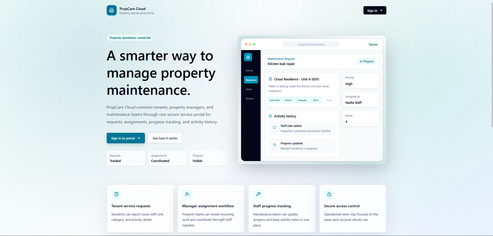
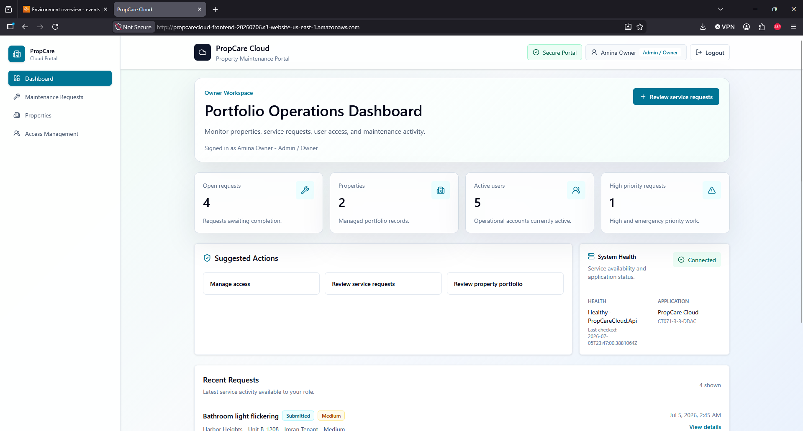
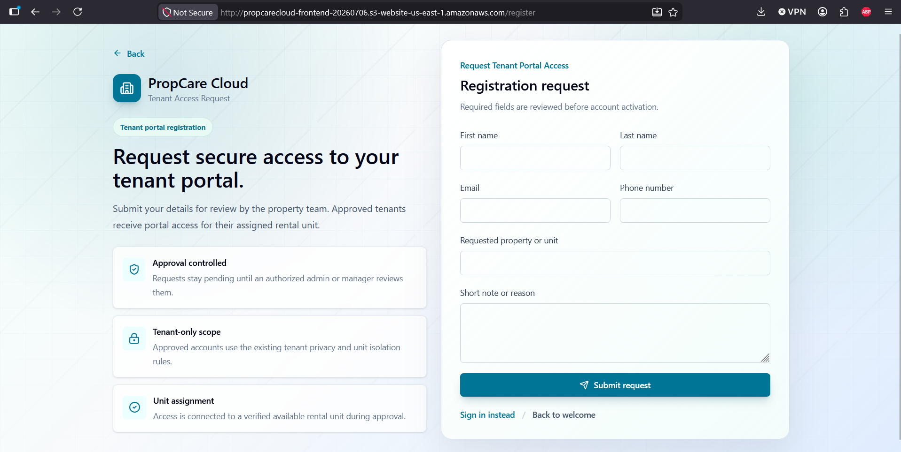
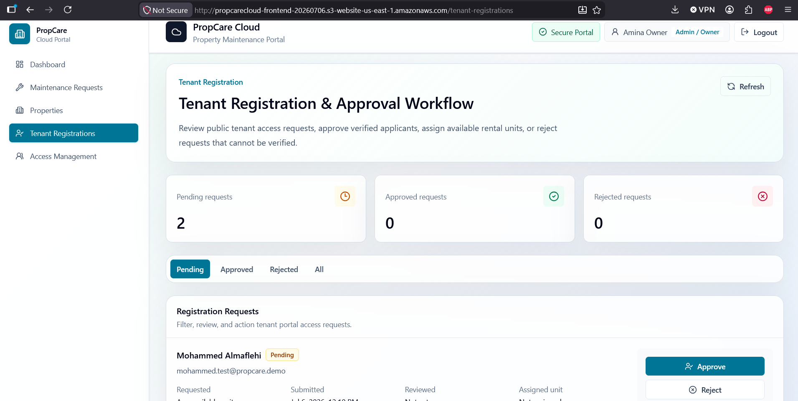
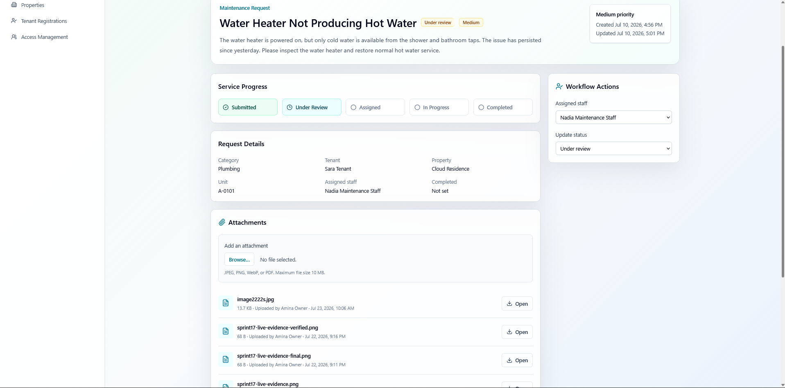
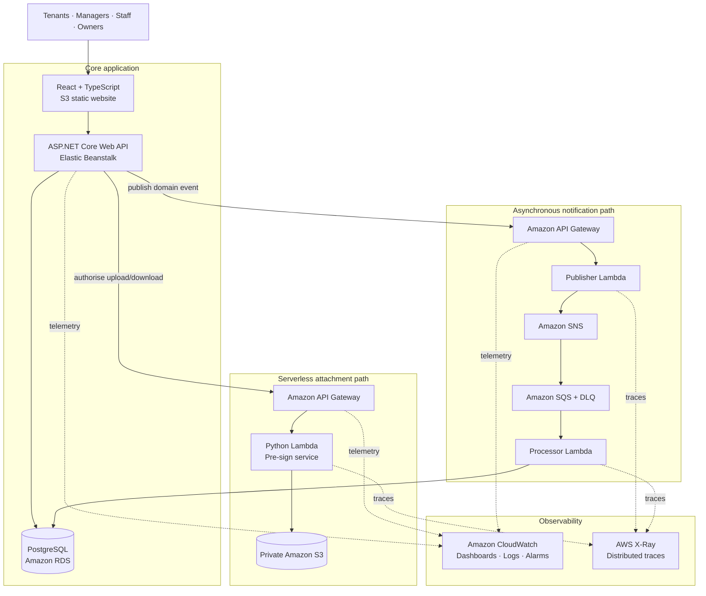

<div align="center">

# PropCare Cloud

### Cloud-native property maintenance operations, from tenant onboarding to monitored service delivery

[](http://propcarecloud-frontend-20260706.s3-website-us-east-1.amazonaws.com/)
[](https://dotnet.microsoft.com/)
[](https://react.dev/)
[](https://aws.amazon.com/rds/postgresql/)
[](#verified-engineering-results)

**A production-style, multi-role property maintenance platform built with React, ASP.NET Core, PostgreSQL, and AWS.**

[Live application](http://propcarecloud-frontend-20260706.s3-website-us-east-1.amazonaws.com/) · [Architecture](#cloud-architecture) · [Features](#product-capabilities) · [Local setup](#run-locally) · [Security](#security-and-privacy)

</div>



## Product Overview

PropCare Cloud connects tenants, property managers, maintenance teams, and portfolio owners through one secure service portal. The platform covers the full maintenance lifecycle: public tenant access requests, approval and unit assignment, issue reporting, staff coordination, status tracking, file attachments, in-app notifications, and operational monitoring.

The project began as a conventional three-tier application and was extended with event-driven and serverless AWS services. The result demonstrates both application engineering and practical cloud architecture without placing AWS credentials or service secrets in the browser.

## Product Capabilities

| Area | What the system delivers |
| --- | --- |
| **Role-based workspaces** | Purpose-built dashboards and navigation for Admin / Owner, Property Manager, Tenant, and Maintenance Staff roles. |
| **Tenant onboarding** | Public access requests, manager review, approval or rejection, account activation, and available-unit assignment. |
| **Property operations** | Property and rental-unit management, occupancy-aware assignments, and portfolio-level visibility. |
| **Maintenance workflow** | Request creation, categorisation, priority, staff assignment, progress states, comments, and activity history. |
| **Tenant isolation** | Tenants can view their own assigned units and maintenance requests; staff see assigned work; managers retain operational oversight. |
| **Secure attachments** | Backend-authorised upload and download flows using API Gateway, Lambda, short-lived pre-signed URLs, and a private S3 bucket. |
| **Async notifications** | Non-blocking event publication through API Gateway, Lambda, SNS, SQS, a dead-letter queue, and a notification processor. |
| **Operational visibility** | RDS-backed notification inbox plus CloudWatch dashboards, alarms, Logs Insights, and AWS X-Ray tracing. |

## Application Showcase

<table>
  <tr>
    <td width="50%"></td>
    <td width="50%"></td>
  </tr>
  <tr>
    <td align="center"><strong>Portfolio operations dashboard</strong><br><sub>Live metrics, suggested actions, system health, and recent service activity.</sub></td>
    <td align="center"><strong>Public tenant onboarding</strong><br><sub>Approval-controlled access requests with tenant privacy and unit assignment.</sub></td>
  </tr>
  <tr>
    <td width="50%"></td>
    <td width="50%"></td>
  </tr>
  <tr>
    <td align="center"><strong>Registration review workflow</strong><br><sub>Admin and manager review with approve, reject, and unit assignment actions.</sub></td>
    <td align="center"><strong>Private maintenance attachments</strong><br><sub>Authorised files linked to requests through the serverless attachment service.</sub></td>
  </tr>
</table>

## Cloud Architecture



### Design Principles

- **Backend-owned trust boundary:** JWT validation, role checks, tenant isolation, attachment authorisation, and service credentials stay server-side.
- **Private object storage:** application files are stored in a private S3 bucket and accessed through short-lived pre-signed URLs.
- **Non-blocking notifications:** business operations remain usable even when notification delivery is temporarily unavailable.
- **Infrastructure as code:** Task 2 serverless resources are described with AWS CloudFormation templates and repeatable deployment scripts.
- **Observable by design:** CloudWatch and X-Ray provide metrics, logs, alarms, and trace-level visibility across serverless flows.

## Technology Stack

| Layer | Technologies |
| --- | --- |
| **Frontend** | React 19, TypeScript, Vite, Tailwind CSS, React Router, Axios, Lucide icons |
| **Backend** | ASP.NET Core 8 Web API, Entity Framework Core, JWT Bearer authentication, BCrypt, Swagger / OpenAPI |
| **Database** | PostgreSQL 16, Amazon RDS for PostgreSQL, EF Core migrations |
| **AWS hosting** | Amazon S3 static website hosting, AWS Elastic Beanstalk, Amazon RDS |
| **Serverless** | Amazon API Gateway, Python 3.12 AWS Lambda, private Amazon S3 |
| **Messaging** | Amazon SNS, Amazon SQS, dead-letter queue processing |
| **Observability** | Amazon CloudWatch dashboards, alarms and Logs Insights; AWS X-Ray |
| **Quality** | xUnit, EF Core in-memory testing, PowerShell validation scripts, TypeScript compiler, Vite production build |

## Verified Engineering Results

The following results are produced by repository validation scripts and the committed test suite:

| Check | Verified result |
| --- | ---: |
| Backend restore | Pass |
| Backend build | Pass — 0 warnings, 0 errors |
| Backend automated tests | **127 passed, 0 failed** |
| Frontend dependency install | Pass |
| Frontend TypeScript + Vite production build | Pass |
| EF Core migrations represented in source | 7 application migrations |
| Task 2 Lambda functions | 3 functions with focused Python tests |

Run the same local checks with:

```powershell
powershell -ExecutionPolicy Bypass -File .\scripts\check-backend.ps1
powershell -ExecutionPolicy Bypass -File .\scripts\check-frontend.ps1
powershell -ExecutionPolicy Bypass -File .\scripts\check-fullstack-local.ps1
```

## Run Locally

### Prerequisites

- .NET SDK 8
- Node.js and npm
- PostgreSQL 16 or a compatible PostgreSQL instance
- PowerShell 7 or Windows PowerShell

### 1. Clone and install

```powershell
git clone https://github.com/ALMAFLEHI/PropCareCloud.git
cd PropCareCloud

cd frontend
npm install
cd ..

dotnet restore .\backend\PropCareCloud.sln
```

### 2. Configure local secrets

The repository intentionally ships with an empty database connection string and empty JWT signing key. Use .NET user-secrets or environment variables; never commit real values.

```powershell
dotnet user-secrets set "ConnectionStrings:DefaultConnection" "Host=localhost;Port=5432;Database=propcarecloud_db;Username=<user>;Password=<password>" --project .\backend\src\PropCareCloud.Api
dotnet user-secrets set "Jwt:SigningKey" "<strong-local-development-key>" --project .\backend\src\PropCareCloud.Api
```

For the frontend, copy `frontend/.env.example` to a local, ignored `.env` file and point it at the API:

```dotenv
VITE_API_BASE_URL=http://localhost:5015
```

### 3. Apply migrations and run

```powershell
dotnet ef database update --project .\backend\src\PropCareCloud.Api --startup-project .\backend\src\PropCareCloud.Api
dotnet run --project .\backend\src\PropCareCloud.Api
```

In a second terminal:

```powershell
cd frontend
npm run dev
```

Open `http://localhost:5173/welcome`. Swagger is available in development mode at `http://localhost:5015/swagger`.

## Project Structure

```text
PropCareCloud/
├── frontend/                 React + TypeScript portal
│   └── src/
│       ├── api/              Typed backend client
│       ├── components/       Shared interface components
│       ├── context/          Authentication state
│       └── pages/            Public and role-protected pages
├── backend/
│   ├── src/PropCareCloud.Api ASP.NET Core API and domain logic
│   └── tests/                xUnit service, RBAC, isolation and persistence tests
├── aws/task2/
│   ├── sprint17/             API Gateway + Lambda + private S3 attachments
│   ├── sprint18/             SNS + SQS notification pipeline
│   └── sprint19/             CloudWatch + X-Ray monitoring
├── scripts/                  Local validation and safe deployment helpers
└── docs/                     Architecture decisions, sprint records and evidence
```

## Security and Privacy

- No AWS access keys, database passwords, production JWT signing keys, private keys, or `.env` files are committed.
- `appsettings.json` keeps `DefaultConnection`, `Jwt:SigningKey`, and Task 2 service API keys empty.
- Passwords are stored as BCrypt hashes; login responses use signed JWTs.
- RBAC is enforced in the backend, not only hidden in the frontend.
- Tenant data is filtered through authenticated user profiles and active unit assignments.
- S3 maintenance attachments remain private and use short-lived, authorised upload/download URLs.
- Infrastructure templates use parameters and deployment-time configuration rather than embedded credentials.

## Current Limitations

- The public demo uses the Amazon S3 website endpoint over HTTP; a custom domain, CloudFront distribution, and TLS certificate are outside this academic project scope.
- Authentication is application-managed JWT authentication rather than Amazon Cognito or another managed identity provider.
- Notification delivery demonstrates the SNS/SQS processing path and an in-app inbox; external email/SMS delivery is not included.
- Live availability depends on the associated AWS learning environment and may be paused to control cost.
- This repository is an academic portfolio project and is not offered as a production service or dependency.

## Documentation

- Architecture and deployment guidance: [`docs/architecture`](docs/architecture)
- Sprint implementation records: [`docs/sprints`](docs/sprints)
- Task 2 infrastructure: [`aws/task2`](aws/task2)
- Backend guide: [`backend/README.md`](backend/README.md)
- Frontend guide: [`frontend/README.md`](frontend/README.md)

## Authors

Built by **Mohammed Abdulsalam Almaflehi** and **Guled Ibrahim** for *CT071-3-3-DDAC — Designing and Developing Applications on the Cloud*.

Repository maintained by [@ALMAFLEHI](https://github.com/ALMAFLEHI).

## Citation

Academic and portfolio references can use the metadata in [`CITATION.cff`](CITATION.cff).

## Usage Notice

No open-source licence is currently granted. Source code is publicly visible for academic review and portfolio demonstration; all rights are reserved by the authors.

<div align="center">

**PropCare Cloud — connected property operations, built and verified on AWS.**

</div>
